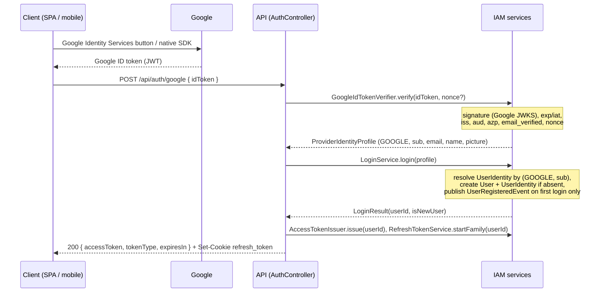
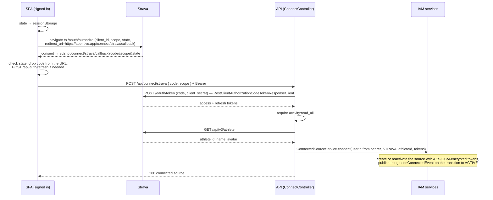

# Identity & Access — API

The HTTP surface of the IAM Bounded Context: Google login (an ID-token exchange), access-token refresh and logout, the Strava connect endpoint, the current-user endpoint, and source/identity management. The backend is a **stateless JSON API**: there are no server-rendered pages, no OAuth redirect endpoints on the backend, and no `HttpSession`. Clients talk to Google and Strava in the browser or on the device; the backend verifies what they bring back. This document is explicit about which parts are Spring Security configuration and which are our code.

Who may create an account, and why sign-in and data sources are separate: [ADR 0011](../../adr/0011-identity-provider-signup.md). Client topology, ID-token login, the security chain and the connect mechanism: [ADR 0012](../../adr/0012-spa-mobile-stateless-api.md). Access and refresh tokens: [ADR 0013](../../adr/0013-access-and-refresh-tokens.md). Own JWT issuer: [ADR 0009](../../adr/0009-identity-spring-security.md). Entities and service seams: [domain-model.md](domain-model.md). Events fired: [events.md](events.md).

## Clients and topology

- The web client is a **React SPA** served from the **same origin** as the API through a reverse proxy: `https://aperitivo.app/` → SPA, `https://aperitivo.app/api/**` → Spring. The browser sees one origin, so **CORS is not enabled at all**. In development a Vite proxy keeps the same arrangement.
- A **mobile app** (post-MVP) uses the same API and the same login endpoint.
- Until the SPA exists, the API is exercised with HTTP clients (Postman, IntelliJ HTTP client) carrying a bearer token; integration tests mint tokens directly. There are no server-rendered pages.

## Endpoint surface

| Method & path | Owner | Auth | Purpose |
|---|---|---|---|
| `POST /api/auth/google` | our controller | none — the credential is the Google ID token in the body | Sign up / sign in: verify the ID token, provision or resolve the user, issue our tokens |
| `POST /api/auth/refresh` | our controller | none — the credential is the `refresh_token` cookie | Rotate the refresh token, issue a new access token |
| `POST /api/auth/logout` | our controller | none — the credential is the `refresh_token` cookie | Revoke the refresh-token family, clear the cookie |
| `GET /.well-known/jwks.json` | our configuration | none | Public keys of our access-token signing key ([jwt-and-keys.md](../../technical-notes/jwt-and-keys.md)) |
| `POST /api/connect/strava` | our controller | **required** (bearer) | Exchange a Strava authorization code, connect the data source |
| `GET /api/me` | our controller | required | Current authenticated user |
| `GET /api/me/sources` | our controller | required | The user's connected data sources |
| `DELETE /api/me/sources/{provider}` | our controller | required | Disconnect a data source |
| `GET /api/me/identities` | our controller | required | The user's sign-in methods |
| `POST /api/me/identities/{provider}` | our controller | required | Link a second sign-in method (when Apple is added; not in MVP) |
| `DELETE /api/me/identities/{provider}` | our controller | required | Remove a sign-in method |

Notes on what is deliberately absent:

- **No signup/registration endpoint.** Provisioning happens implicitly inside `POST /api/auth/google` on the first login for a given Google `sub`.
- **No Strava login endpoint.** Strava is not a sign-in method; connecting it requires our bearer token. See [ADR 0011](../../adr/0011-identity-provider-signup.md).
- **No backend OAuth redirect or callback endpoints.** There is no `/oauth2/authorization/*`, `/login/oauth2/code/*` or `/connect/**` path on the backend. `https://aperitivo.app/connect/strava/callback` is an **SPA route**, not a Spring endpoint.
- **No REST endpoint for Strava tokens.** Those are accessed only in-process via `TokenManager`.
- **The Strava deauthorization webhook is not here.** It is received by Activity Ingestion's `WebhookController` and routed back to `ConnectedSourceService.markRevoked` — see the "three channels" section of [domain-model.md](domain-model.md).

---


## Authentication model

**Two tokens with different jobs** ([ADR 0013](../../adr/0013-access-and-refresh-tokens.md)):

| | Access token | Refresh token |
|---|---|---|
| Format | RS256 JWT minted by our `JwtEncoder` | opaque, 256 random bits, base64url |
| Lifetime | **15 minutes** | 14 days of inactivity; the family has an absolute lifetime of 30 days |
| Claims / content | `sub` = internal `user_id` (UUID), `iss`, `aud` = `aperitivo-api`, `iat`, `exp`, `jti` — nothing else | none; only its SHA-256 hash is stored, in `refresh_tokens` ([database.md](database.md)) |
| Delivered in | JSON body of `/api/auth/google` and `/api/auth/refresh` | web: `refresh_token` cookie; native (post-MVP): response body |
| Sent as | `Authorization: Bearer <access token>` on `/api/**` | the cookie, which the browser attaches only to `/api/auth/*` |
| Kept by the SPA in | a JavaScript variable (memory) — never `localStorage` | nowhere: `HttpOnly`, unreadable by script |
| Validated by | the resource server, **by signature, `iss`, `aud` and `exp` only** — no database or Redis lookup | `RefreshTokenService`, by hash lookup, on refresh and logout only |

The application is a Spring Security **resource server**. Every request to `/api/**` other than the three `/api/auth/*` endpoints is authenticated by validating our access token with **our** `JwtDecoder` and converting it into a `CurrentUser(UUID userId)` principal. Other modules depend on `CurrentUser` from IAM's published API, never on JWT or OAuth types.

**Refresh cookie attributes (web):** `refresh_token=<opaque>; HttpOnly; Secure; SameSite=Strict; Path=/api/auth`. `HttpOnly` keeps it away from every script; `Secure` confines it to HTTPS; `SameSite=Strict` stops the browser sending it on any cross-site request; `Path=/api/auth` means it never accompanies an ordinary API call. For native clients the refresh token is returned in the response body and kept in Keychain/Keystore; the mechanism that selects body vs cookie is specified when a native client exists.

**A Google ID token is never a bearer token on the API.** Google controls its lifetime, its `sub` is the provider's identifier rather than our `user_id`, and we can neither revoke it nor add claims to it. It proves identity once, at `POST /api/auth/google`, and is then discarded. A test asserts that a valid Google ID token is rejected with `401` on `/api/**`.

**Clients do not send `Authorization` to `/api/auth/**`.** An expired bearer token on a `permitAll` endpoint would still fail in `BearerTokenAuthenticationFilter` with `401` — which would, for example, break a refresh attempted precisely because the access token has expired.

**CSRF protection is disabled.** API requests authenticate by a header the browser never attaches by itself, so there is no ambient credential to forge. The only cookie-borne credential is the refresh cookie, and it is protected by three things together: `SameSite=Strict`; the `/api/auth/*` endpoints accepting only `application/json` (a cross-origin JSON `POST` needs a CORS preflight, which no origin passes); and CORS being off.

**No per-request denylist in the MVP.** Logout revokes the refresh-token family; the access token stays valid for at most 15 minutes. `jti` is still minted to keep a future "revoke now" (bans, forced logout) open — see [ADR 0013](../../adr/0013-access-and-refresh-tokens.md) §5.

---

## Security filter chain

**One stateless `SecurityFilterChain`, deny by default** ([ADR 0012](../../adr/0012-spa-mobile-stateless-api.md) §3):

| Path | Rule |
|---|---|
| `POST /api/auth/google`, `POST /api/auth/refresh`, `POST /api/auth/logout` | `permitAll` — their credential (the ID token or the refresh cookie) is checked by the controller |
| `GET /.well-known/jwks.json`, `GET /actuator/health`, `/error` | `permitAll` |
| `/api/**` | `authenticated` (our bearer token) |
| anything else | `denyAll` |

- **No `securityMatcher`.** Requests that match no chain bypass Spring Security entirely, and Boot's default chain backs off as soon as any `SecurityFilterChain` bean exists, so a matcher-scoped chain would silently leave every other path (for example actuator endpoints) unprotected. A test asserts that an unknown path is rejected.
- **`sessionManagement(STATELESS)`**, and no component creates an `HttpSession`. A test asserts that no response sets `JSESSIONID`.
- **Our decoder is passed explicitly** to the resource server. The Google ID-token verifier is deliberately **not** a `JwtDecoder` bean, so the resource server can never pick it up by accident.
- Unauthenticated requests get `401` with a Problem Details body from a custom `AuthenticationEntryPoint`.
- No `oauth2Login`, no `oauth2Client`, no form login, no HTTP Basic.

```java
// Illustrative — the single chain.
@Bean
SecurityFilterChain apiSecurityFilterChain(HttpSecurity http,
                                           JwtDecoder accessTokenDecoder,                       // OUR decoder
                                           Converter<Jwt, AbstractAuthenticationToken> currentUserConverter,
                                           AuthenticationEntryPoint problemDetailsEntryPoint) throws Exception {
    http
        // no securityMatcher: this chain sees every request
        .authorizeHttpRequests(auth -> auth
            .requestMatchers(HttpMethod.POST, "/api/auth/google", "/api/auth/refresh", "/api/auth/logout").permitAll()
            .requestMatchers(HttpMethod.GET, "/.well-known/jwks.json", "/actuator/health").permitAll()
            .requestMatchers("/error").permitAll()
            .requestMatchers("/api/**").authenticated()
            .anyRequest().denyAll())
        .sessionManagement(s -> s.sessionCreationPolicy(SessionCreationPolicy.STATELESS))
        .csrf(AbstractHttpConfigurer::disable)
        .exceptionHandling(e -> e.authenticationEntryPoint(problemDetailsEntryPoint))
        .oauth2ResourceServer(rs -> rs
            .authenticationEntryPoint(problemDetailsEntryPoint)
            .jwt(jwt -> jwt
                .decoder(accessTokenDecoder)                       // never a Google decoder
                .jwtAuthenticationConverter(currentUserConverter))); // Jwt → CurrentUser(userId)
    return http.build();
}
```

`accessTokenDecoder` validates our RS256 signature and the `iss`, `aud` (`aperitivo-api`) and `exp` claims; key loading and JWKS are in [jwt-and-keys.md](../../technical-notes/jwt-and-keys.md).

---

## Two provider flows, two different mechanisms

This is the single most important implementation detail in this document. Login and connect both start in the client and both end with the client calling our API, but they use **different protocols**, start from **different authentication states**, and write to **different tables**.

| | Login (Google) | Connect (Strava) |
|---|---|---|
| Protocol | OIDC — the client obtains an **ID token** | OAuth 2.0 authorization code, **confidential client** |
| Browser / device leg | Google Identity Services button (web) or the native Google SDK (mobile) | the SPA navigates to Strava's authorize URL; Strava redirects back to the SPA route `/connect/strava/callback` |
| Backend endpoint | `POST /api/auth/google { idToken }` | `POST /api/connect/strava { code, scope }` |
| Caller | anonymous | **already authenticated** by our bearer token |
| Spring component on the backend | `GoogleIdTokenVerifier` (`NimbusJwtDecoder` + `OidcIdTokenValidator`) | `RestClientAuthorizationCodeTokenResponseClient` + the `strava` `ClientRegistration` |
| CSRF / forgery guard | JSON-only, no CORS, optional `nonce` | `state`, generated and verified by the SPA |
| Provider tokens | ID token verified once and discarded | access + refresh tokens stored AES-GCM encrypted |
| Writes | `users`, `user_identities` (and a `refresh_tokens` row when our tokens are issued) | `connected_sources` |
| Where `user_id` comes from | created or resolved from the provider's `(issuer, sub)` | our own bearer token — **never** from Strava |
| Result | our access token + refresh cookie | an `ACTIVE` `ConnectedSource` |

Consequences that are easy to get wrong:

1. **Connect can never authenticate anyone.** `POST /api/connect/strava` requires our bearer token, reads the `user_id` from the `CurrentUser` principal, and has no code path that mints our tokens. Completing a Strava authorization therefore cannot change who you are logged in as, and a Strava code is structurally useless as a login backdoor.
2. **The SPA owns the browser leg of connect; the backend owns the confidential leg.** The SPA generates and verifies `state` — which is what defeats a forged callback that would attach an attacker's Strava account to the victim's user. The backend exchanges the code with the `client_secret`, which never leaves the server; the code is single-use and useless without it.
3. **The code exchange does not fetch the athlete profile.** The connect handler calls `GET /api/v3/athlete` **explicitly** (via `StravaApiClient`) to learn the athlete id, which is the `provider_user_id` on the `ConnectedSource`.
4. **Only OIDC providers can be login methods**, since an ID token is required. Strava — plain OAuth 2.0, no ID token, no email — cannot be, which is consistent with [ADR 0011](../../adr/0011-identity-provider-signup.md).

**Configuration.** Both providers keep their `ClientRegistration` in `application.yaml`. The `google` registration is reused as configuration for the verifier (client ID, issuer); the `strava` registration carries the client secret, endpoints and scopes for the code exchange. The Strava `redirect-uri` is the SPA route, and the same value is sent in the authorize request (by the SPA) and in the token request (by the backend):

```yaml
spring.security.oauth2.client.registration.strava.redirect-uri: "https://aperitivo.app/connect/strava/callback"   # per environment
```

---

## Flow 1 — login with Google



The detailed diagram with transaction boundaries: [google-login.md](diagrams/sequence/google-login.md).

### `POST /api/auth/google`

**Request:**

```http
POST /api/auth/google
Content-Type: application/json

{ "idToken": "eyJhbGciOiJSUzI1NiIsImtpZCI6…" }
```

```java
public record GoogleLoginRequest(
        String idToken,   // Google ID token — never the Google access token
        String nonce      // optional; see below
) {}
```

The client obtains a Google **ID token**. The Google **access token** is never requested or accepted: it is meant for Google APIs and is not bound to our audience, so using it as proof of identity would enable token substitution. When the client passed a `nonce` to Google, the backend compares it with the token's `nonce` claim; how the client supplies the expected value is specified at implementation time.

**Verification — Spring Security components, not hand-written code.** Encapsulated in the IAM component `GoogleIdTokenVerifier`:

```java
// Illustrative — the decoder is a private field, NOT a JwtDecoder bean.
@Component
class GoogleIdTokenVerifier {

    private final JwtDecoder googleIdTokenDecoder;

    GoogleIdTokenVerifier(ClientRegistrationRepository registrations) {
        ClientRegistration google = registrations.findByRegistrationId("google");
        NimbusJwtDecoder decoder = NimbusJwtDecoder
                .withIssuerLocation("https://accounts.google.com")     // Google JWKS, cached, selected by kid
                .build();
        decoder.setJwtValidator(JwtValidators.createDefaultWithValidators(
                new OidcIdTokenValidator(google),                        // iss, aud (our client ID), azp
                new JwtClaimValidator<Boolean>("email_verified", Boolean.TRUE::equals)));
        this.googleIdTokenDecoder = decoder;
    }

    ProviderIdentityProfile verify(String idToken, @Nullable String expectedNonce) {
        Jwt jwt = googleIdTokenDecoder.decode(idToken);                  // signature, exp/iat + validators
        // compare jwt.getClaimAsString("nonce") with expectedNonce when one was supplied
        // map sub, email, name, picture → ProviderIdentityProfile(GOOGLE, …)
    }
}
```

Google ID tokens may carry `iss` as either `accounts.google.com` or `https://accounts.google.com`; an integration test with real tokens pins this down, and both forms are accepted if needed.

**Provisioning.** `LoginService.login(profile)` resolves the `UserIdentityEntity` by `(GOOGLE, sub)` and either touches `lastLoginAt` or creates a `UserEntity` + `UserIdentityEntity` and publishes `UserRegisteredEvent` — exactly as [ADR 0011](../../adr/0011-identity-provider-signup.md) specifies. It returns `LoginResult(userId, isNewUser)`. Token issuance happens **outside** `login(...)` — our tokens are a transport concern of the login endpoint, not part of the provisioning transaction (see [domain-model.md](domain-model.md#why-it-returns-a-value-and-not-void)).

**Response `200`:**

```http
HTTP/1.1 200 OK
Content-Type: application/json
Set-Cookie: refresh_token=<opaque>; HttpOnly; Secure; SameSite=Strict; Path=/api/auth; Max-Age=<refresh lifetime>

{ "accessToken": "eyJhbGciOiJSUzI1NiIsImtpZCI6…", "tokenType": "Bearer", "expiresIn": 900 }
```

A successful login starts a **new refresh-token family** (one sign-in on one device).

**No Google tokens are stored.** The ID token is discarded once the identity is established; there is no background work to do on the user's behalf at Google. `user_identities` has no token columns ([database.md](database.md)).

**Onboarding routing is the client's.** A brand-new account has *no data whatsoever*. The SPA reads `GET /api/me` after login and, while `sources` is empty, routes the user to the connect step ([ADR 0011](../../adr/0011-identity-provider-signup.md) §5) — the same rule covers a returning user who never connected anything.

**Failures.** A missing, malformed, expired or otherwise invalid ID token (bad signature, wrong `aud`/`azp`, `email_verified` not `true`, `nonce` mismatch) → `401` Problem Details. No `User`, no `UserIdentity`, no event, no cookie. A non-JSON request → `415`.

---

## Refresh and logout

### `POST /api/auth/refresh`

Called by the SPA on page load (it keeps the access token only in memory) and whenever the access token is about to expire or has expired. The SPA shares **a single in-flight refresh across tabs**.

**Request:** the `refresh_token` cookie, attached by the browser; `Content-Type: application/json` (an empty `{}` body); **no `Authorization` header**.

Each call ([ADR 0013](../../adr/0013-access-and-refresh-tokens.md) §3):

1. looks up the presented token by SHA-256 hash and checks that it is unexpired, unused and not revoked, and that its family is within the 30-day absolute lifetime;
2. marks it `used_at = now`;
3. issues a **new** refresh token in the **same family** and a new access token.

**Response `200`:** the same body as login, and a `Set-Cookie` carrying the rotated refresh token.

```json
{ "accessToken": "eyJhbGciOiJSUzI1NiIsImtpZCI6…", "tokenType": "Bearer", "expiresIn": 900 }
```

**Reuse detection.** Presenting an **already-used** token means two parties hold it. The server cannot tell which one is legitimate, so it **revokes the whole family** and answers `401`; both must sign in again through Google, and only the legitimate user can. To keep two tabs refreshing at the same instant from looking like theft, the just-rotated token stays acceptable for a **grace window of 10–30 s** (the exact value is set at implementation time).

**Failures.** No cookie, an unknown, expired or revoked token, a family past its absolute lifetime, or detected reuse → `401` Problem Details. The client then shows the Google sign-in.

### `POST /api/auth/logout`

**Request:** the `refresh_token` cookie; `Content-Type: application/json`; no `Authorization` header — logout identifies the session by the refresh cookie, so it works even when the access token has expired.

**Effect:** revokes the **family** of the presented refresh token and clears the cookie with the same `Path` and attributes:

```http
HTTP/1.1 204 No Content
Set-Cookie: refresh_token=; HttpOnly; Secure; SameSite=Strict; Path=/api/auth; Max-Age=0
```

**Idempotent.** No cookie, an unknown token or an already-revoked family still answer `204` and clear the cookie.

The client discards the in-memory access token and calls `google.accounts.id.disableAutoSelect()`, so Google One Tap does not sign the user straight back in. Our logout does not sign the user out of Google.

**The access token stays valid for at most 15 minutes after logout.** This is accepted: logout ends a session; theft is handled by rotation and family revocation. **"Log out everywhere"** revokes every family of the user; its endpoint is specified at implementation time.

---

## Flow 2 — connect Strava



The detailed diagram with transaction boundaries: [strava-connect.md](diagrams/sequence/strava-connect.md).

### `POST /api/connect/strava`

**Request:**

```http
POST /api/connect/strava
Authorization: Bearer <access token>
Content-Type: application/json

{ "code": "a1b2c3…", "scope": "read,activity:read_all,profile:read_all" }
```

`code` and `scope` are the values Strava appended to the SPA callback route. Before calling, the SPA has verified `state` against `sessionStorage`, removed `code` from the URL, and made sure it holds a fresh access token.

**Handling:**

1. The code is exchanged server-side with the `strava` `ClientRegistration`:

   ```java
   // Illustrative.
   ClientRegistration strava = registrations.findByRegistrationId("strava");
   OAuth2AuthorizationExchange exchange = new OAuth2AuthorizationExchange(
           OAuth2AuthorizationRequest.authorizationCode()
                   .authorizationUri(strava.getProviderDetails().getAuthorizationUri())
                   .clientId(strava.getClientId())
                   .redirectUri(strava.getRedirectUri())   // the SPA route, as in the authorize request
                   .scopes(strava.getScopes())
                   .build(),
           OAuth2AuthorizationResponse.success(request.code())
                   .redirectUri(strava.getRedirectUri())
                   .build());
   OAuth2AccessTokenResponse tokens = new RestClientAuthorizationCodeTokenResponseClient()
           .getTokenResponse(new OAuth2AuthorizationCodeGrantRequest(strava, exchange));
   ```

2. Strava lets the user deselect scopes, so a connection without `activity:read_all` is **rejected**.
3. `GET /api/v3/athlete` yields the athlete id.
4. `ConnectedSourceService.connect(currentUser.userId(), STRAVA, athleteId, tokens)` creates or reactivates the source.

The `userId` written to `connected_sources` comes **only from our bearer token**. Strava contributes the athlete id and the tokens, and nothing else. Identity is never inferred from a data-source provider ([ADR 0011](../../adr/0011-identity-provider-signup.md) §3).

`ConnectedSourceService.connect` covers first connect, no-op re-connect of an already-active source, and reactivation after a revoke; which of those fires `IntegrationConnectedEvent` is specified in [domain-model.md](domain-model.md) and [events.md](events.md). Reactivation is **in-place** for the same athlete — see the reconnect table in [database.md](database.md).

**Response:** `200` with the connected source (`SourceDto`, below); the exact success shape is fixed at implementation time.

> We do **not** use Spring Security's `OAuth2AuthorizedClientService` as a token store. Strava tokens live in our `ConnectedSource` (owned by IAM, accessed only via `TokenManager`) — see [ADR 0003](../../adr/0003-token-storage-strategy.md). The `OAuth2AccessTokenResponse` is a transient carrier from which we extract the tokens once.

**Failures.** No or expired bearer → `401`. Missing `code`, a failed exchange (invalid, expired or already-used code), a missing `activity:read_all` scope, or a failed athlete lookup → a Problem Details error; error types are fixed at implementation time. No `ConnectedSource` is created or modified and no event is emitted. **The user stays signed in** — a failed connect has no bearing on their tokens.

**Conflict.** If that Strava athlete is already connected to a different Aperitivo user, the connect is rejected with `409 …/errors/source-already-linked`. The source is never moved between accounts silently.

---


## `GET /api/me`

Returns the authenticated user. Auth required (bearer); `401` otherwise.

**Response `200`:**

```json
{
  "id": "3a9e2c7e-…",
  "displayName": "Andrii K.",
  "email": "andrii@example.com",
  "avatarUrl": "https://…/avatar.jpg",
  "identities": [
    { "provider": "GOOGLE", "linkedAt": "2026-06-01T10:00:00Z" }
  ],
  "sources": [
    { "provider": "STRAVA", "status": "ACTIVE", "connectedAt": "2026-06-01T10:04:12Z" }
  ],
  "createdAt": "2026-06-01T10:00:00Z"
}
```

```java
public record UserDto(
        UUID              id,
        String            displayName,
        String            email,        // nullable — a provider may not release it
        String            avatarUrl,    // nullable
        List<IdentityDto> identities,   // how this user signs in — never empty
        List<SourceDto>   sources,      // connected data sources — MAY be empty
        Instant           createdAt
) {}

public record IdentityDto(
        IdentityProvider provider,      // GOOGLE in MVP
        Instant          linkedAt
) {}

public record SourceDto(
        Provider     provider,          // STRAVA in MVP
        SourceStatus status,            // ACTIVE | REVOKED | ERROR
        Instant      connectedAt
) {}
```

**`sources` is a list, and it may be empty.** That is not an edge case to code around — it is the normal state of every account between signing up and connecting something, and the permanent state of anyone who never connects. Clients must render an empty state (or the onboarding connect step), not an error. The previous single-valued `connection` field could not express this, because under the old model a user could not exist without a Strava source.

**`identities` is never empty** — invariant 4 in [domain-model.md](domain-model.md). Both lists deliberately omit provider user ids: the Google `sub` and the Strava athlete id are internal join keys, not client-facing data.

`sources` carries only IAM-owned health (`provider`, `status`) — enough for the UI to show "connected" vs "reconnect needed". It deliberately does **not** carry ingestion/backfill progress ("imported 124 of 540") — that is Activity Ingestion's concern, surfaced via SSE, not here. The `user_id` is taken from the `CurrentUser` principal (our access token's `sub`); the endpoint never trusts a client-supplied id. Profile data lives here rather than in the access token, whose claims are deliberately minimal.

---

## `GET /api/me/sources`

The user's connected data sources — the same `SourceDto` list as above, for clients that only need the sources panel. Returns `200` with an array, possibly empty.

## `DELETE /api/me/sources/{provider}`

Disconnects a data source: sets it to `REVOKED` with reason `USER_REQUESTED` and publishes `IntegrationRevokedEvent`, so Ingestion stops scheduling syncs. Returns `204`.

Disconnecting a source **never** deletes the account and never touches `user_identities` — the user remains able to sign in and keeps their already-imported history. This is the disconnect half of the symmetry the connect flow creates: what an authenticated user attached, an authenticated user can detach. Under the previous model this endpoint could not exist as a plain `DELETE`, because removing the Strava source removed the only way to log in.

`404 …/errors/source-not-found` if the user has no source for that provider.

## `GET /api/me/identities`

The user's sign-in methods — the `IdentityDto` list. Returns `200`.

## `POST /api/me/identities/{provider}` (when Apple is added)

Links a second sign-in method to the authenticated user. The body is `{ "idToken": "…" }` from that provider's client SDK, verified by the same verifier mechanism as login ([ADR 0012](../../adr/0012-spa-mobile-stateless-api.md) §5). The rules of [ADR 0011](../../adr/0011-identity-provider-signup.md) §4 hold unchanged: login never merges, and a provider identity already bound to a different user is `409 …/errors/identity-already-linked` — never a re-assignment. Not part of the MVP surface, where Google is the only identity provider.

## `DELETE /api/me/identities/{provider}`

Removes a sign-in method. Returns `204`.

Rejected with `409 …/errors/last-identity` when it is the only remaining method: the account would still hold every workout the user ever imported while nobody could log into it. There is no support path to recover from that, so the API refuses rather than offering a confirmation dialog.

In MVP, with Google as the only identity provider, every user has exactly one identity — so this endpoint always returns `409`. It is specified now because the guard, not the endpoint, is the part that must exist before a second provider is added.

---

## Errors

| Status | When |
|---|---|
| `400 Bad Request` | Malformed request body (e.g. missing `idToken` or `code`) |
| `401 Unauthorized` | On `/api/**`: no access token, expired token, bad signature, wrong `iss`/`aud` — including a Google ID token presented as a bearer. On `/api/auth/google`: an invalid ID token. On `/api/auth/refresh`: a missing, unknown, expired, revoked or reused refresh token |
| `403 Forbidden` | An authenticated request to a path outside the allow-list (`denyAll`); the same request without a token gets `401` |
| `404 Not Found` | `…/errors/source-not-found` — disconnecting a provider the user has not connected |
| `409 Conflict` | `…/errors/source-already-linked`, `…/errors/identity-already-linked`, `…/errors/last-identity` |
| `415 Unsupported Media Type` | A non-JSON request to `/api/auth/*` |

Every endpoint returns JSON; there are no backend redirects. Error bodies follow the project-wide [API error conventions](../../conventions/api-errors.md) (RFC 7807 `application/problem+json`); the `401` body is written by the custom `AuthenticationEntryPoint`.

Conflict bodies name the constraint but never the other account:

```json
{
  "type": "https://aperitivo.dev/errors/source-already-linked",
  "title": "Data source already linked",
  "status": 409,
  "detail": "This Strava account is already connected to another Aperitivo user.",
  "instance": "/api/connect/strava"
}
```

Naming the other user — or even confirming their email — would turn a conflict response into an account-enumeration oracle. The `detail` is deliberately as unhelpful as it can be while still telling the user what happened.

---

## What is intentionally NOT in this API (MVP)

- **No server-side session.** No `HttpSession`, no Spring Session, no sticky routing; every API request is authenticated by its bearer token alone.
- **No per-request `jti` denylist.** Revocation is by refresh-token family; residual access after logout is bounded by the 15-minute access-token lifetime ([ADR 0013](../../adr/0013-access-and-refresh-tokens.md)).
- **No CORS.** The SPA is same-origin behind the reverse proxy.
- **No refresh token in the response body for web clients.** The body transport exists only for native clients, post-MVP.
- **No profile-update endpoint.** `UserService.updateProfile` exists in the domain model but is not exposed in the MVP surface; profile fields come from the identity provider at provisioning.
- **No Strava-token endpoints.** `TokenManager` is an in-process interface used only by Activity Ingestion — never HTTP.
- **No account-merge endpoint.** Two accounts are never merged; see the alternatives section of [ADR 0011](../../adr/0011-identity-provider-signup.md).
- **No account-deletion endpoint** in MVP. Erasure spans all six BCs, so it is not an IAM-only concern.
- **No admin/roles endpoints.** Single user type in MVP (see [database.md](database.md)).

---

## Next documents in this BC

- Sequence diagrams: [google-login.md](diagrams/sequence/google-login.md), [strava-connect.md](diagrams/sequence/strava-connect.md), [revocation-flow.md](diagrams/sequence/revocation-flow.md)
- [domain-model.md](domain-model.md), [database.md](database.md), [events.md](events.md) — already written
- [token-management.md](../../technical-notes/token-management.md) — already written
- [jwt-and-keys.md](../../technical-notes/jwt-and-keys.md) — `JwtEncoder`/`JwtDecoder` setup, RS256 key loading, JWKS, access/refresh lifetimes
