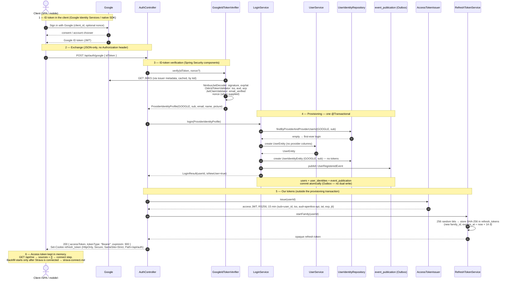

# Sequence: Google login

The full "Sign in with Google" flow, from the button click to our tokens, for a **first-time** sign-up. The client obtains a Google **ID token** itself and exchanges it at `POST /api/auth/google`; the backend verifies it, provisions the user, and issues our access and refresh tokens. The diagram shows which parts are Spring Security components (`GoogleIdTokenVerifier`) and which are our code (the auth controller, `LoginService.login`, token issuance), the single transaction in which the user, the identity, and the event-publication row are committed (the Outbox), and what does **not** happen: no backend redirect, no `HttpSession`, no Strava call, no Google tokens stored, no `ConnectedSource`.

Who may create an account, and why sign-in is separate from data sources: [ADR 0011](../../../../adr/0011-identity-provider-signup.md). ID-token login and the stateless API: [ADR 0012](../../../../adr/0012-spa-mobile-stateless-api.md). Our access and refresh tokens: [ADR 0013](../../../../adr/0013-access-and-refresh-tokens.md). Provisioning detail: [domain-model.md](../../domain-model.md). Endpoint and auth detail: [api.md](../../api.md). Event contracts: [events.md](../../events.md).

## Notes on the flow

- **Phase 1 is entirely client-side.** On the web the SPA uses the Google Identity Services button; on mobile, the native Google SDK. Both return the same kind of ID token. The Google **access token** is never requested or sent to us: it is meant for Google APIs and is not bound to our audience, so accepting it as proof of identity would enable token substitution. There is no backend redirect, so there is no `state`, saved request or `SecurityContext` to keep in an `HttpSession`.
- **Phase 2 is a plain JSON call.** `POST /api/auth/google` is `permitAll` in the security chain; its credential is the ID token in the body, checked by the controller. The client sends no `Authorization` header to `/api/auth/**`. Login CSRF — a third-party page submitting an attacker's ID token from the victim's browser — is mitigated by accepting only `application/json` (a cross-origin JSON `POST` needs a CORS preflight, which no origin passes), by CORS being off, and by the optional `nonce`.
- **Phase 3 uses Spring Security, not hand-written crypto.** `GoogleIdTokenVerifier` wraps a `NimbusJwtDecoder.withIssuerLocation("https://accounts.google.com")` validated by `JwtValidators.createDefaultWithValidators(new OidcIdTokenValidator(googleRegistration))` plus an `email_verified` `JwtClaimValidator`. The existing `google` `ClientRegistration` supplies the client ID and issuer. The decoder is **not** a `JwtDecoder` bean, so the resource server can never mistake a Google token for ours. The ID token is why this provider can establish identity; Strava has no equivalent — plain OAuth 2.0, no ID token, and [no email in the default scope](../../../../adr/0011-identity-provider-signup.md) — which is why it is not a sign-in method.
- **Phase 4 is provisioning, and it is one transaction** — unchanged by [ADR 0012](../../../../adr/0012-spa-mobile-stateless-api.md). Inside a single `@Transactional` method the `UserIdentityEntity` lookup decides register-vs-login, a `UserEntity` and `UserIdentityEntity` are created on first login, and `UserRegisteredEvent` is published. Spring Modulith writes the event row into `event_publication` **in that same transaction** — business state and event commit together or not at all (Outbox; no dual write). In the current code this is `OAuth2GoogleLoginCallbackService.handleLogin`.
- **Nothing here touches `connected_sources`.** No Strava call, no token acquisition, no encryption, no `ACTIVE`/`REVOKED` reasoning, no reconnect branch. That is the whole point of [ADR 0011](../../../../adr/0011-identity-provider-signup.md): login is login. The Google ID token is discarded after phase 3 — we have no reason to call Google again on the user's behalf, which is why `user_identities` has no token columns ([database.md](../../database.md)).
- **Phase 5 delivers our identity.** The access token is a 15-minute RS256 JWT whose `sub` is the internal `user_id` — never the provider's `sub` — returned in the JSON body; the SPA keeps it in memory and sends it as `Authorization: Bearer`. The refresh token is opaque, stored only as a hash, and starts a new **family** (one sign-in on one device); on the web it travels only in the `HttpOnly` `refresh_token` cookie, scoped to `/api/auth`. Issuance happens after the provisioning transaction: tokens are a transport concern of the endpoint, not part of provisioning ([domain-model.md](../../domain-model.md#why-it-returns-a-value-and-not-void)). Lifetimes and rotation: [ADR 0013](../../../../adr/0013-access-and-refresh-tokens.md).
- **Phase 6 is a deliberate dead end.** `UserRegisteredEvent` has **no consumer** in the MVP, so no delivery arrow is drawn. Nothing is ingested, because there is nothing to ingest. The SPA sees an empty `sources` list on `GET /api/me` and routes the user to the connect step instead of an empty dashboard.

## Login variations (not redrawn)

The diagram is the **first-time sign-up**. The other case differs only in phase 4:

- **Returning user.** `login(...)` finds the `UserIdentityEntity` by `(GOOGLE, sub)`, touches `lastLoginAt`, and creates nothing. **No event** is emitted. Phases 1–3 and 5 are identical: the user receives a fresh access token and a refresh token in a **new** family. Whether they have a connected Strava source is irrelevant to this flow — a revoked or missing source changes nothing about the ability to log in.
- **Page reload with a live refresh cookie.** Not a login at all: the SPA calls `POST /api/auth/refresh`, which rotates the refresh token and returns a new access token without any Google round-trip ([api.md](../../api.md)).

## Failure paths (not redrawn)

- **User cancels the Google prompt** → nothing reaches our API.
- **ID-token verification fails** (bad signature, wrong `aud`/`azp`, `email_verified` not `true`, `nonce` mismatch, expired) → `401` Problem Details. No `User`, no `UserIdentity`, no event, no tokens, no cookie.
- Because provisioning is one transaction, a failure anywhere in phase 4 rolls back the whole thing — including the `event_publication` row — so no event is ever delivered for a login that did not fully succeed.

## Related

- [strava-connect.md](strava-connect.md) — the separate flow that creates a `ConnectedSource` and actually triggers ingestion
- [domain-model.md](../../domain-model.md) — `LoginService`, `RefreshTokenService`, the three external channels, the `sub = user_id` rule
- [api.md](../../api.md) — endpoint contracts, the security filter chain, access/refresh token model
- [events.md](../../events.md) — `UserRegisteredEvent` contract and what it does not imply
- [ADR 0011](../../../../adr/0011-identity-provider-signup.md) — why signup and source connection are separate
- [ADR 0012](../../../../adr/0012-spa-mobile-stateless-api.md), [ADR 0013](../../../../adr/0013-access-and-refresh-tokens.md) — ID-token login; access and refresh tokens
