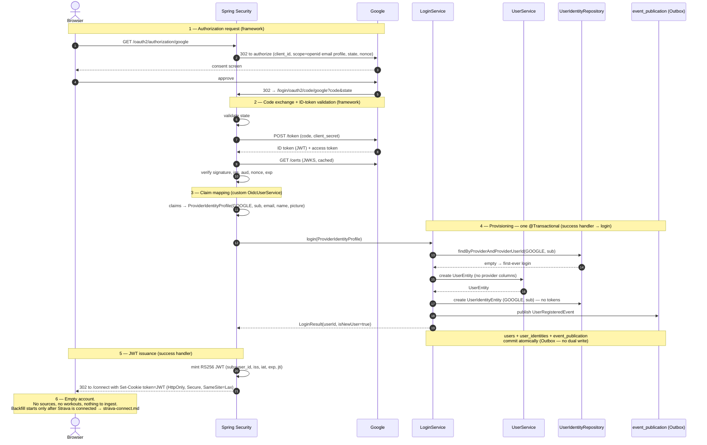

# Sequence: Google login

The full "Sign in with Google" flow, from the initial click to JWT issuance, for a **first-time** sign-up. It shows which parts are Spring Security framework behaviour and which are our seams (`OidcUserService`, the success handler, `LoginService.login`), the single transaction in which the user, the identity, and the event-publication row are committed (the Outbox), and what does **not** happen: no Strava call, no tokens, no `ConnectedSource`.

Who may create an account, and why sign-in is separate from data sources: [ADR 0011](../../../../adr/0011-identity-provider-signup.md). Provisioning detail: [domain-model.md](../../domain-model.md). Endpoint and auth detail: [api.md](../../api.md). Event contracts: [events.md](../../events.md).

## Notes on the flow

- **Phases 1–2 are pure framework.** We write no controller for the authorize redirect or the code exchange; we supply the `ClientRegistration` (client id/secret, `openid email profile`) in configuration. We are a **confidential** client, so the code-for-token exchange is server-to-server. The `state` parameter is the framework's CSRF guard for the OAuth flow; the `nonce` binds the ID token to this specific authorization request.
- **The ID token is why this provider can establish identity.** Google is OIDC, so the token response carries a signed JWT whose `sub` is a stable subject identifier, validated against Google's JWKS before any of our code runs. Strava has no equivalent — plain OAuth 2.0, no ID token, and [no email in the default scope](../../../../adr/0011-identity-provider-signup.md) — which is the empirical reason it is not a sign-in method.
- **Phase 3 is our first seam,** and it is small: map validated claims onto a `ProviderIdentityProfile`. Note it is `oidcUserService(...)`, not `userService(...)` — an OIDC provider uses the `OidcUserService` type.
- **Phase 4 is provisioning, and it is one transaction.** Inside a single `@Transactional` method: the `UserIdentityEntity` lookup decides register-vs-login, a `UserEntity` and `UserIdentityEntity` are created on first login, and `UserRegisteredEvent` is published. Spring Modulith writes the event row into `event_publication` **in that same transaction** — business state and event commit together or not at all (Outbox; no dual write).
- **Nothing here touches `connected_sources`.** No Strava call, no token acquisition, no encryption, no `ACTIVE`/`REVOKED` reasoning, no reconnect branch. That is the whole point of [ADR 0011](../../../../adr/0011-identity-provider-signup.md): login is login. Google's own access token is discarded — we have no reason to call Google again on the user's behalf, which is why `user_identities` has no token columns ([database.md](../../database.md)).
- **Phase 5 delivers the identity.** The success handler mints our RS256 JWT (`sub` = internal `user_id`, never the provider's `sub`) and sets it as the `HttpOnly; Secure; SameSite=Lax` cookie. API clients read the token and send it as an `Authorization` header instead — same token, two transports (see [api.md](../../api.md)).
- **Phase 6 is a deliberate dead end.** `UserRegisteredEvent` has **no consumer** in the MVP, so no delivery arrow is drawn. Nothing is ingested, because there is nothing to ingest. `isNewUser=true` is what routes the user to the connect step instead of to an empty dashboard.

## Login variations (not redrawn)

The diagram is the **first-time sign-up**. The other case differs only in phase 4:

- **Returning user.** `login(...)` finds the `UserIdentityEntity` by `(GOOGLE, sub)`, touches `lastLoginAt`, and creates nothing. **No event** is emitted. Phases 1–3 and 5 are identical; the user receives a fresh JWT and lands on the app home rather than the connect page. Whether they have a connected Strava source is irrelevant to this flow — a revoked or missing source changes nothing about the ability to log in.

## Failure paths (not redrawn)

- **User denies consent**, or the **code exchange fails**, or **ID-token validation fails** (bad signature, wrong `aud`, replayed `nonce`, expired) → Spring Security's failure handler redirects to the login page with an error indication. No `User`, no `UserIdentity`, no event.
- Because provisioning is one transaction, a failure anywhere in phase 4 rolls back the whole thing — including the `event_publication` row — so no event is ever delivered for a login that did not fully succeed.

## Related

- [strava-connect.md](strava-connect.md) — the separate flow that creates a `ConnectedSource` and actually triggers ingestion
- [domain-model.md](../../domain-model.md) — `LoginService`, the three external channels, the `sub = user_id` rule
- [api.md](../../api.md) — endpoint surface, the `oauth2Login` vs `oauth2Client` split, cookie/header token model
- [events.md](../../events.md) — `UserRegisteredEvent` contract and what it does not imply
- [ADR 0011](../../../../adr/0011-identity-provider-signup.md) — why signup and source connection are separate
