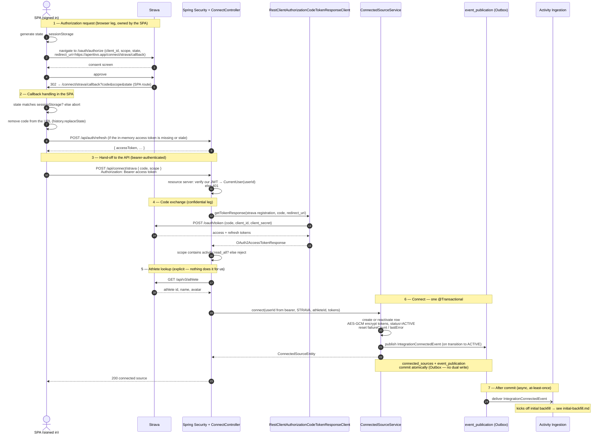

# Sequence: Strava connect

Connecting a Strava account as a **data source**, initiated by an **already-signed-in** user from inside the SPA. This is the flow that acquires Strava tokens, creates the `ConnectedSource`, and triggers ingestion — everything the login flow deliberately does not do.

It is a **client-driven authorization-code flow**: the SPA owns the browser leg (it generates and verifies `state`, and Strava redirects back to an SPA route), and the backend owns the confidential leg (it exchanges the code with the `client_secret`). There is no backend redirect and no `HttpSession`.

The critical property: **this flow cannot log anyone in.** `POST /api/connect/strava` requires our bearer token and has no code path that mints our tokens. The `user_id` written to `connected_sources` comes from our access token, never from Strava.

Decision: [ADR 0011](../../../../adr/0011-identity-provider-signup.md) (topology), [ADR 0012](../../../../adr/0012-spa-mobile-stateless-api.md) §4 (mechanism). Token storage: [ADR 0003](../../../../adr/0003-token-storage-strategy.md). Endpoint detail: [api.md](../../api.md). Event contracts: [events.md](../../events.md).

## Notes on the flow

- **Phase 1 is the SPA's, and `state` is its security control.** The SPA generates `state`, keeps it in `sessionStorage`, and sends it in the authorize request. That is what defeats a forged callback that would attach an attacker's Strava account to the victim's user ([RFC 6749 §10.12](https://www.rfc-editor.org/rfc/rfc6749#section-10.12)). The `redirect_uri` is an **SPA route** — `https://aperitivo.app/connect/strava/callback` — not a backend path; the backend exposes no `/connect/**` endpoint. Hiding the "Connect Strava" button for signed-out visitors is presentation; the bearer requirement in phase 3 is what makes the flow safe.
- **Phase 2 keeps the code out of the URL and gets a fresh token.** The code is removed from the address bar immediately, so it does not linger in history or leak via `Referer`. Because the SPA holds its access token only in memory, the full-page return from Strava usually means it must call `POST /api/auth/refresh` first ([ADR 0013](../../../../adr/0013-access-and-refresh-tokens.md)).
- **Phase 3 is where identity is fixed.** `POST /api/connect/strava` is under `/api/**`, so the single security chain requires our access token; the resource server turns it into `CurrentUser(userId)`. That `userId` — and nothing Strava returns — is the owner of the new source.
- **Phase 4 is the confidential leg.** The backend exchanges the code with Spring Security's `RestClientAuthorizationCodeTokenResponseClient` and the existing `strava` `ClientRegistration`, so the `client_secret` never leaves the server. The `redirect_uri` sent here must equal the one the SPA used in phase 1, which is why it is the registration's configured `redirect-uri`. The code is single-use and useless without the secret. Strava lets the user deselect scopes, so a connection without `activity:read_all` is rejected before anything is stored.
- **Phase 5 is explicit because nothing does it for us.** The code exchange yields tokens; the handler calls `GET /api/v3/athlete` itself to obtain the athlete id, which becomes `provider_user_id` on the `ConnectedSource`.
- **Phase 6 is one transaction,** and it is the only place `connected_sources` is written during a user-initiated flow. Tokens are AES-GCM encrypted by the entity converter; the DB never sees plaintext. The Strava tokens live **only** in our `ConnectedSource` — Spring's `OAuth2AuthorizedClientService` is not our token store ([ADR 0003](../../../../adr/0003-token-storage-strategy.md)); the `OAuth2AccessTokenResponse` is a transient carrier we read once.
- **The event fires on the transition, not on the request.** Re-running the connect flow against an already-`ACTIVE` source refreshes its tokens and publishes **nothing** — no state changed. See the three cases tabulated in [domain-model.md](../../domain-model.md).
- **Phase 7 is after commit.** Only once the transaction has committed does Modulith deliver `IntegrationConnectedEvent` to Activity Ingestion (`@ApplicationModuleListener`, async, at-least-once). This is the **sole** trigger for the initial backfill — see [initial-backfill.md](../../../activity-ingestion/diagrams/sequence/initial-backfill.md).

## Variations (not redrawn)

- **Reconnect after a revoke, same athlete.** Phases 1–5 are identical. In phase 6 the existing row is **reactivated in place** — tokens overwritten, `failureCount`/`lastError` reset, status back to `ACTIVE` — because `UNIQUE (provider, provider_user_id)` makes a second row impossible. The transition **does** emit `IntegrationConnectedEvent`, so phase 7 runs and Ingestion resumes (incremental catch-up via the existing `SyncCursor`; full backfill only if none exists — Ingestion's decision, not encoded in the event). Note the consequence for consumers: `connectedSourceId` is **unchanged**, so it is not a valid per-occurrence dedup key ([events.md](../../events.md)).

  Writing fresh tokens onto a `REVOKED` row without restoring `ACTIVE` is the specific bug this step exists to prevent: the user would see a successful reconnect while `TokenManager` kept rejecting every request as inactive, and ingestion would stay silently dead.

- **Re-connect of an already-active source.** Tokens and scopes are refreshed; no transition, **no event**, no backfill.

- **Connecting a different Strava athlete.** A new row is inserted; the old revoked row is kept for history (permitted by the partial unique index). See the reconnect table in [database.md](../../database.md).

## Failure paths (not redrawn)

- **`state` mismatch or missing** → the SPA aborts in phase 2; the code is never sent to the API.
- **No or expired bearer on `POST /api/connect/strava`** (and the refresh failed) → `401`. Nothing is exchanged.
- **User denies consent** → Strava redirects back without a code; the SPA shows an error and calls nothing.
- **The code exchange fails** (invalid, expired or already-used code), **`activity:read_all` is missing**, or **`GET /api/v3/athlete` fails** → a Problem Details error. No `ConnectedSource` is created or modified, no event is emitted, and **the user stays signed in** — a failed connect has no bearing on their tokens.
- **The athlete is already connected to another Aperitivo user** → `409 …/errors/source-already-linked`. The source is never silently moved between accounts, and the response never identifies the other account ([api.md](../../api.md)).
- Because phase 6 is one transaction, a failure inside it rolls back the state change **and** the `event_publication` row, so no event is ever delivered for a connect that did not fully succeed.

## Related

- [google-login.md](google-login.md) — the separate flow that creates the account this connect attaches to
- [revocation-flow.md](revocation-flow.md) — the reverse transition, and what triggers it
- [token-refresh.md](token-refresh.md) — what happens to the stored Strava tokens afterwards
- [domain-model.md](../../domain-model.md) — `ConnectedSourceService.connect`, the three external channels
- [api.md](../../api.md) — login vs connect mechanisms, endpoint contracts, error shapes
- [events.md](../../events.md) — `IntegrationConnectedEvent` contract and dedup guidance
- [initial-backfill.md](../../../activity-ingestion/diagrams/sequence/initial-backfill.md) — the backfill that phase 7 triggers
