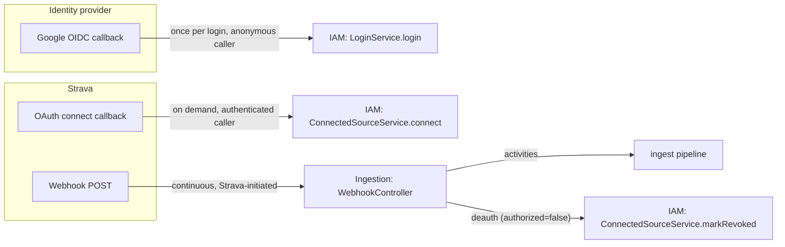

# Identity & Access — Domain Model

The domain model for the Identity & Access (IAM) Bounded Context: the data it owns, the services that act on it, the events it emits, and the invariants that hold.

Style: Spring layered (see [ADR 0005](../../adr/0005-bounded-contexts.md)) — entities are plain data, services hold all logic. Naming follows [conventions/naming.md](../../conventions/naming.md).

## Responsibility recap

IAM answers three questions:
1. **Who is this user?** — the internal `UserEntity` (a stable UUID identity), reached through one or more `UserIdentityEntity` sign-in methods.
2. **What external sources have they connected, and are those connections healthy?** — `ConnectedSourceEntity` and its lifecycle.
3. **How do we authenticate them and let the rest of the system authorize them?** — Google OIDC login plus our own JWT issuance.

### Identity is not a data source

The single most important distinction in this BC, and the one [ADR 0011](../../adr/0011-identity-provider-signup.md) exists to fix:

| | `UserIdentityEntity` | `ConnectedSourceEntity` |
|---|---|---|
| Answers | "how does this person sign in" | "where do we fetch training data from" |
| Provider | `IdentityProvider` — `GOOGLE` (future: `APPLE`) | `Provider` — `STRAVA` (future: `GARMIN`, …) |
| Tokens | **none stored** — discarded once the ID token is validated | the substance of the entity, AES-GCM encrypted |
| Status | it exists or it does not | `ACTIVE` / `REVOKED` / `ERROR`, `failureCount`, `lastError` |
| Read by | the login flow, once per login | `TokenManager` and Activity Ingestion, continuously |
| Created by | signup (anonymous caller) | the connect flow (authenticated caller) |

They share a shape — both are `(provider, providerUserId)` pointing at a `userId` — and nothing else. Merging them would subject sign-in methods to a revocation lifecycle, a refresh sweep and a failure counter that mean nothing for an identity, and would eventually let a token-refresh job try to refresh someone's ability to log in.

## Entities

Entities are plain data: fields, JPA/Hibernate mapping, audit/lifecycle annotations. No behavior.

### UserEntity

The internal identity record. Holds nothing provider-specific.

```java
@Entity
@Table(name = "users")
public class UserEntity {
    @Id
    private UUID id;                 // internal identity, our UUID

    private String displayName;      // from the identity provider's profile at signup
    private String email;            // nullable; the account's contact address — see below
    private String avatarUrl;        // nullable; identity provider's picture claim

    @CreationTimestamp
    private Instant createdAt;
    @UpdateTimestamp
    private Instant updatedAt;
}
```

`UserEntity` has **no** `status`, **no** tokens, and **no** provider columns — not `strava_*`, and equally not `google_sub`. Sign-in methods live on `UserIdentityEntity`; provider data concerns live on `ConnectedSourceEntity`.

`email` is the account's **single contact address**, seeded from the identity provider at signup. It has exactly one consumer: the Notifications BC, whose `EmailChannelAdapter` needs one address per user to deliver to — a "your Strava connection broke, please reconnect" mail has to go somewhere. That is the whole justification for the column; nothing else reads it. Notifications reaches it through the `UserContactReader` published port (below), never by querying this table.

It stays **nullable** even though Google always supplies a verified address. Tightening it to `NOT NULL` would block a future identity provider: Facebook documents that the field *"will not be returned if no valid email address is available"* (phone-only registration, or a declined `email` permission). Notifications must therefore treat "no address" as a normal state and fall back to the in-app channel, not as an error. See [ADR 0011](../../adr/0011-identity-provider-signup.md).

It is emphatically **not an identifier.** No lookup, join, or account match keys off it — see `providerUserId` below.

### UserIdentityEntity

A sign-in method: proof that some external identity provider vouches for this person. One user may have several (Google today, Apple later); each is unique across the system.

```java
@Entity
@Table(name = "user_identities")
public class UserIdentityEntity {
    @Id
    private UUID id;

    private UUID userId;                    // id-reference to UserEntity (NOT a JPA association)

    @Enumerated(EnumType.STRING)
    private IdentityProvider provider;      // GOOGLE (future: APPLE)

    private String providerUserId;          // the provider's `sub` claim — never the email

    @CreationTimestamp
    private Instant createdAt;

    private Instant lastLoginAt;            // nullable; updated on each successful login
}
```

**No tokens.** The identity provider's access and refresh tokens are worthless to us the moment the ID token is validated: Google supplies no training data, and we never call its API again. Storing them would create a secret with no purpose and a rotation obligation with no benefit.

**No email either.** The provider's email claim is read at login and written to `UserEntity.email`, which is the account's single contact address. Keeping a second per-identity copy would be a column with **no reader**: email is never a join key by decision (see below), so nothing may query it, and with one identity provider in MVP the value is by construction identical to `users.email`. It would only double the PII surface that account erasure has to reach. If a second provider ever makes "which provider asserted which address" worth answering, it returns as an additive nullable column.

**`providerUserId` is the provider's `sub`, never the email.** Google states plainly that the email claim *"may not be unique to this account and could change over time, therefore you shouldn't use this value as the primary identifier to link to your user record"*; Apple gives the same guidance, and its Hide My Email relay addresses are per-development-team anyway. This is what makes the email a display/contact attribute and nothing more — it never resolves, matches or merges accounts.

So the row holds exactly what a sign-in method *is*: which provider, which subject, and when it was last used.

### ConnectedSourceEntity

A credentialed link from a user to an external **data** provider, with its own lifecycle. Created by the connect flow, never by login.


```java
@Entity
@Table(name = "connected_sources")
public class ConnectedSourceEntity {
    @Id
    private UUID id;

    private UUID userId;                  // id-reference to UserEntity (NOT a JPA association)

    @Enumerated(EnumType.STRING)
    private Provider provider;            // STRAVA (future: GARMIN, …)

    private String providerUserId;        // e.g. strava_athlete_id, as string

    @Convert(converter = EncryptedBytesConverter.class)
    private String accessToken;           // stored AES-GCM encrypted (bytea on disk)
    @Convert(converter = EncryptedBytesConverter.class)
    private String refreshToken;          // stored AES-GCM encrypted (bytea on disk)
    private Instant accessTokenExpiresAt;

    @Type(StringArrayType.class)
    private String[] scopes;              // granted OAuth scopes (Postgres text[])

    @Enumerated(EnumType.STRING)
    private SourceStatus status;          // ACTIVE, REVOKED, ERROR

    private int failureCount;
    private String lastError;             // nullable

    private Instant lastRefreshedAt;      // nullable
    private Instant lastUsedAt;           // nullable

    @Version
    private long version;                 // optimistic lock — guards concurrent refresh

    @CreationTimestamp
    private Instant createdAt;
    @UpdateTimestamp
    private Instant updatedAt;
}
```

### Enums and value objects

No suffix (they are domain types, per the naming convention).

```java
public enum IdentityProvider {
    GOOGLE
    // future: APPLE
}

public enum Provider {
    STRAVA
    // future: GARMIN, WAHOO, COROS, SUUNTO, POLAR, TRAININGPEAKS
}

public enum SourceStatus {
    ACTIVE,    // tokens valid, sync allowed
    REVOKED,   // user/Strava revoked access; no sync; needs reconnect
    ERROR      // transient failure; retry policy applies
}

// immutable data holders (records)
public record StravaTokens(String accessToken, String refreshToken,
                           Instant expiresAt, String[] scopes) {}

public record StravaProfile(String athleteId, String displayName,
                            String email, String avatarUrl) {}

public record ProviderIdentityProfile(IdentityProvider provider, String providerUserId,
                              String email, String displayName, String avatarUrl) {}

public record LoginResult(UUID userId, boolean isNewUser) {}  // what login returns

public record StravaToken(String accessToken) {}   // what TokenManager hands to Ingestion
```

`IdentityProvider` and `Provider` are **two enums, deliberately**. A single merged enum would imply a `GOOGLE` value is a legal argument to `TokenManager.getValidAccessToken` or to `findByUserIdAndProvider` on `connected_sources` — the compiler should reject that, not a code reviewer.


## Persistence policy — Hibernate use in IAM

IAM deliberately uses **no JPA associations**. `ConnectedSourceEntity.userId` is a plain `UUID`, not a `@ManyToOne UserEntity`. Navigation is via repository methods.

Rationale:
- `UserEntity` and `ConnectedSourceEntity` are **separate aggregates** with independent lifecycles ([ADR 0004](../../adr/0004-user-model-and-connected-sources.md)). DDD guidance: reference across aggregate boundaries by id, not by object association.
- Avoids any chance of tokens being pulled in transitively when reading a user (a `@OneToMany` would make that a footgun in a logger or serializer).
- Makes N+1 structurally impossible here: there is no lazy collection to trigger it. Reads are always explicit (`connectedSourceRepository.findByUserIdAndProvider(...)`).

This does **not** mean "no Hibernate." IAM uses the Hibernate features that *fit* an association-free design:
- `@Convert` with a custom `AttributeConverter` (`EncryptedBytesConverter`) for AES-GCM column encryption.
- A custom type for the Postgres `text[]` `scopes` column.
- `@Version` optimistic locking on `ConnectedSourceEntity` — directly relevant to concurrent token refresh (see [token-management.md](../../technical-notes/token-management.md)).
- Auditing via `@CreationTimestamp` / `@UpdateTimestamp`.

The full association toolkit (`@OneToMany`, fetch strategies, `@BatchSize`, entity graphs, cascades, orphan removal, second-level cache) is exercised in **Workout Catalog** and **Training Planning**, *within* their aggregates, where it is architecturally correct. Each such choice is documented with its rationale in those BCs.

## Repositories

Spring Data JPA, no logic.

```java
public interface UserRepository extends JpaRepository<UserEntity, UUID> {
}

public interface UserIdentityRepository extends JpaRepository<UserIdentityEntity, UUID> {
    Optional<UserIdentityEntity> findByProviderAndProviderUserId(IdentityProvider provider, String providerUserId);
    List<UserIdentityEntity> findByUserId(UUID userId);
    long countByUserId(UUID userId);          // guards "cannot remove the last sign-in method"
}

public interface ConnectedSourceRepository extends JpaRepository<ConnectedSourceEntity, UUID> {
    Optional<ConnectedSourceEntity> findByProviderAndProviderUserId(Provider provider, String providerUserId);
    Optional<ConnectedSourceEntity> findByUserIdAndProvider(UUID userId, Provider provider);
    List<ConnectedSourceEntity> findByUserId(UUID userId);
    List<ConnectedSourceEntity> findByStatus(SourceStatus status);
}
```

## Services — where all logic lives

Five services, by responsibility.

### LoginService — signup and login

The IAM entry point for the **identity channel** (see "Three external channels" below). Runs once per login. It **never touches `connected_sources`**.

```java
@Service
public class LoginService {

    @Transactional
    public LoginResult login(ProviderIdentityProfile identity) {
        // 1. resolve UserIdentityEntity by (provider, providerUserId)
        // 2. found      → touch lastLoginAt, return LoginResult(userId, false)
        //    not found  → create UserEntity + UserIdentityEntity,
        //                 publish UserRegisteredEvent,
        //                 return LoginResult(userId, true)
        // 3. the AuthenticationSuccessHandler mints the JWT from the result
    }
}
```

Compare this with what login used to do. It no longer acquires, encrypts or stores tokens; it has no `ACTIVE`/`REVOKED`/`ERROR` to reason about; it has no reconnect branch. All of that moved to `ConnectedSourceService`, reached through the connect flow — which is where a connection lifecycle belongs. A login is now exactly what its name says.

An unmatched `(provider, providerUserId)` **always** creates a new account. It is never matched against an existing user by email, and never merged — see the linking rules in [ADR 0011](../../adr/0011-identity-provider-signup.md).

#### Why it returns a value and not `void`

The published events do **not** carry the login result back to the caller, and cannot:

- **Different delivery semantics.** Events are `AFTER_COMMIT` + `@Async` — they run on another thread *after* the transaction commits, by which point the HTTP response is being written. A listener has no way to put a JWT into that response.
- **Different audience.** The events tell *other* BCs to react. Login itself is a synchronous request/response inside IAM: the `AuthenticationSuccessHandler` needs the `user_id` **now**, in the same request, to mint `sub` and set the cookie.
- **Self-consumption is a smell.** Per [events/conventions.md](../../events/conventions.md), a BC consuming its own events is a design smell; driving login off an IAM event would be exactly that.

So: "publish and forget" applies to the cross-BC side effects, not to the primary result of the use case.

The return type is a narrow `LoginResult` record, **not** the `UserEntity`. A JPA entity handed back across the transaction boundary is detached — any lazy access blows up, and it invites accidental serialization of persisted state into a response. `isNewUser` lets the handler branch without a second query, and that branch now matters more than it used to: a newly registered user has **no data at all**, so the handler sends them into the mandatory connect step rather than to an empty dashboard.

### UserIdentityService — sign-in methods

Owns the set of ways a given user can authenticate.

```java
@Service
public class UserIdentityService {
    List<UserIdentityEntity> findByUserId(UUID userId);
    UserIdentityEntity link(UUID userId, ProviderIdentityProfile identity);   // from settings, authenticated
    void unlink(UUID userId, IdentityProvider provider);
}
```

Two rules it enforces, both from [ADR 0011](../../adr/0011-identity-provider-signup.md):

- **`link` never steals.** If `(provider, providerUserId)` already belongs to a different `userId`, it fails with a conflict rather than re-pointing the row — answered as `409 …/errors/identity-already-linked` (see [api.md](api.md)).
- **`unlink` never orphans.** Removing the last remaining sign-in method is rejected; `countByUserId` is the guard.

Linking is always initiated by an **authenticated** user from settings. There is no matching by email and no login-time merge prompt.

### UserService — identity CRUD

```java
@Service
public class UserService {
    UserEntity findById(UUID userId);
    UserEntity createFromProviderIdentityProfile(ProviderIdentityProfile profile);
    void updateProfile(UUID userId, ProfileUpdateDto update);
}
```

Knows nothing about tokens and nothing about data sources.

### ConnectedSourceService — connection lifecycle

Owns the whole `ConnectedSource` lifecycle: creation from the connect flow, reactivation on reconnect, and the `ACTIVE → REVOKED / ERROR` transitions. Emits `IntegrationConnectedEvent` and `IntegrationRevokedEvent`.

```java
@Service
public class ConnectedSourceService {
    ConnectedSourceEntity connect(UUID userId, Provider provider,
                                  String providerUserId, StravaTokens tokens);
    void markRevoked(UUID userId, Provider provider, RevocationReason reason);
    void markError(UUID userId, Provider provider, String error);
    void recordSuccessfulUse(UUID userId, Provider provider);
    List<ConnectedSourceEntity> findByUserId(UUID userId);
    Optional<ConnectedSourceEntity> findActive(UUID userId, Provider provider);
}
```

`connect` is the single entry point for the connect flow, and it covers three cases:

| Case | Effect | `IntegrationConnectedEvent` |
|---|---|---|
| No source for `(provider, providerUserId)` | create, `ACTIVE` | published |
| Source exists and is `ACTIVE` | refresh the stored tokens and scopes | **not** published — no transition |
| Source exists and is `REVOKED`/`ERROR` | refresh tokens, reset `failureCount`/`lastError`, set `ACTIVE` | published |

Writing fresh tokens onto a `REVOKED` row *without* restoring `ACTIVE` is the failure mode this table exists to prevent: the user would appear to reconnect successfully while `TokenManager` kept rejecting every request as inactive. The event fires on the **transition**, mirroring the guard in `markRevoked` — see invariant 6 and [events.md](events.md).

If `(provider, providerUserId)` is already connected to a **different** user, `connect` fails with a conflict (`409 …/errors/source-already-linked`) rather than moving the source.


### TokenManager — sole token gatekeeper

The only code in the entire system that reads, decrypts, or refreshes tokens. Activity Ingestion calls **only** this. Keeps the `Manager` suffix to signal that role (see naming conventions).

```java
@Service
public class TokenManager {
    StravaToken getValidAccessToken(UUID userId);     // hot path; lazy refresh under per-user lock
    void markRevoked(UUID userId, RevocationReason reason);
    void recordFailure(UUID userId, FailureKind kind);
    void recordSuccessfulUse(UUID userId);
}
```

Refresh mechanics (per-user lock, lazy vs proactive, 401 handling) are detailed in [token-management.md](../../technical-notes/token-management.md). This BC doc fixes only the contract.

### UserContactReader — the contact-address port

IAM's second published port, and the **only** way another BC obtains a user's contact address.

```java
public interface UserContactReader {
    Optional<String> emailFor(UUID userId);    // empty = this account has no address
}
```

Narrow on purpose: one method, one field, read-only, `Optional` rather than `null`. It is the `TokenManager` pattern applied to contact data — a stable interface in IAM's base package, implemented in `internal/`, called synchronously by exactly one consumer.

**Why a port and not an event field.** Notifications is the only BC that needs the address, but it consumes six events from four BCs. Carrying the address on those payloads would force Analytics, Ingestion, and Planning to know a user's email — data none of them has any business holding — and Spring Modulith **serializes event payloads into `event_publication`**, so every send would durably copy the address into the outbox as JSON. Account erasure would then have to reach into outbox blobs across four modules. A port keeps the address in exactly one column, in one table, in one BC.

**Why not a Notifications-owned projection.** A local copy is a third address to keep correct, needs a new "email changed" event to stay fresh, and reintroduces the same erasure surface. The port reads the live row instead.

**Read at delivery time, not at dispatch time.** Delivery is deferred — `DeliveryAttempt`s are enqueued `QUEUED` and drained later by a worker, with backoff retries in between. Resolving the recipient when the attempt is *created* would risk sending a retried message to an address the user has since changed, and would store a copy of it on `delivery_attempts`. So the address is resolved twice, for two different questions:

| Caller | Question | On empty `Optional` |
|---|---|---|
| `NotificationDispatchService` (gate) | does this account have an address at all? | skip the EMAIL channel — enqueue no attempt for it |
| `EmailChannelAdapter` (send) | what address, right now? | terminal failure for that attempt |

The gate check matters because `email` is nullable: without it, an addressless account would get a `QUEUED` EMAIL attempt that is guaranteed to fail, and Notifications would dutifully emit `NotificationFailed` for a situation that is not a failure. "No address" is a normal state, and the in-app channel is the fallback — see the `email` rationale above and [ADR 0011](../../adr/0011-identity-provider-signup.md).

### Supporting collaborators

- `StravaOAuthClient` — a thin HTTP wrapper over Strava's OAuth token endpoint (`POST /oauth/token`), used by the connect flow (code exchange) and by `TokenManager` (refresh). Lives in IAM.
- `StravaApiClient` — used by the connect flow to read `GET /api/v3/athlete` and obtain the athlete id. This call is now **explicit**: `oauth2Client` does not invoke an `OAuth2UserService`, so nothing fetches the profile for us the way `oauth2Login` did.

## Three external channels — critical distinction

External systems reach us through **three independent channels**, owned by **different BCs** and carrying different meaning. Confusing them is a design error.



- **Identity channel** → IAM. Google's OIDC callback, from an **anonymous** caller. Creates or resolves a `User`. Handled by `LoginService.login`. Touches `users` and `user_identities` only.
- **Connect channel** → IAM. Strava's OAuth callback, from an **already-authenticated** caller (the `user_id` comes from our JWT, not from the provider). Creates or reactivates a `ConnectedSource`. Handled by `ConnectedSourceService.connect`. Touches `connected_sources` only.
- **Webhook channel** → Activity Ingestion's `WebhookController`. Continuous, Strava-initiated. Carries activity create/update/delete **and** deauthorization (`aspect_type=update, updates.authorized=false`). Deauth is routed back to IAM's `ConnectedSourceService.markRevoked`, but it arrives via the webhook channel, not either OAuth callback.

The first two are both browser OAuth redirects and superficially look alike. They are not: they use different Spring Security machinery (`oauth2Login` vs `oauth2Client`), start from different authentication states, and write to different tables. See [api.md](api.md).

## Identity tokens — the `sub` claim

The JWT we issue carries our **internal `user_id` (UUID)** as `sub`. Never `providerUserId`.

```
JWT claims:
  sub = user_id (UUID)          ← our stable internal identity
  iss = https://aperitivo.<…>   ← issuer (us)
  iat, exp (24–72h), jti
```

**Two different things are called `sub`, and they must never be conflated:**

| | Meaning | Where it lives |
|---|---|---|
| Our JWT `sub` | the internal `user_id` (UUID) | minted by us; the FK target across all six BCs |
| Google's `sub` | Google's subject identifier | stored as `UserIdentityEntity.providerUserId` |

Why our `sub` must be `user_id`:
- `sub` identifies the user **in our system**; our identity handle is `user_id`, stable for the life of the account.
- A provider's `sub` is an attribute of *one sign-in method*. A user with both Google and Apple has two of them — there is no single value to put in `sub`.
- `providerUserId` on a `ConnectedSource` is even less suitable: it identifies a *data source*, which the user may disconnect entirely without ceasing to exist.

No provider identifier ever enters the JWT. The Strava athlete id is needed only by Activity Ingestion when talking to Strava, and is read from `ConnectedSourceEntity`.

JWT issuance/validation mechanics (RS256 keys, JWKS, `jti` blacklist) are covered in [jwt-and-keys.md](../../technical-notes/jwt-and-keys.md).

## Events published

All via `ApplicationEventPublisher`, consumed after commit (`@TransactionalEventListener(AFTER_COMMIT)` / `@ApplicationModuleListener` on the consumer side). Events are records, not Spring `ApplicationEvent` subclasses.

| Event | Emitted by | When |
|---|---|---|
| `UserRegisteredEvent` | `LoginService` | a new `UserEntity` is created (first login) |
| `IntegrationConnectedEvent` | `ConnectedSourceService` | a `ConnectedSourceEntity` transitions to `ACTIVE` (connect or reconnect) |
| `IntegrationRevokedEvent` | `ConnectedSourceService` | a source transitions `ACTIVE → REVOKED` |

**These two no longer coincide.** Under the previous model both fired from the same login transaction, so "a user exists" and "a data source exists" were the same moment. They are now separated by an arbitrary interval — signup, then whenever the user completes the connect step, possibly never. Consumers must not assume that a `UserRegisteredEvent` implies any source, and `IntegrationConnectedEvent` is the **sole** trigger for ingestion backfill. See [ADR 0011](../../adr/0011-identity-provider-signup.md).

Payload schemas: see [events.md](events.md).

## Events consumed

None from inside the system. External inputs are the Google OIDC callback and the Strava connect callback (both handled here) and the Strava deauthorization webhook (handled in Ingestion, routed back to `ConnectedSourceService`).

## Invariants

Enforced by services and the schema, not by entity behavior.

1. **`UserEntity` holds no provider-specific fields** — no `strava_*`, and no `google_sub` either. Enforced by code review and an architecture test asserting the field set.
2. **`(provider, provider_user_id)` is unique** in `user_identities` and, independently, in `connected_sources`. DB unique constraints; the resolving query checks before creating.
3. **A sign-in method belongs to exactly one user.** Linking an identity already bound elsewhere is a conflict, never a re-assignment.
4. **Every user has at least one sign-in method.** `unlink` refuses to remove the last one; otherwise the account becomes unreachable while its data lives on.
5. **At most one non-revoked `ConnectedSourceEntity` per `(userId, provider)`.** Enforced by a partial unique index on `(user_id, provider)` where `status <> 'REVOKED'`.
6. **Every transition *to* `ACTIVE` emits `IntegrationConnectedEvent`, and every transition to `REVOKED` emits `IntegrationRevokedEvent`** — on the transition only, never on a no-op re-application. Otherwise Ingestion would either never start syncing a reconnected source or keep running jobs against a dead one.
7. **Tokens never leave `TokenManager` in plaintext** except at the moment of a Strava API call. No other component decrypts them. Identity providers contribute no tokens at all.
8. **Concurrent refresh is serialized per user.** Guarded by `@Version` optimistic locking plus the per-user lock described in the token-management note.
9. **The contact address leaves IAM only through `UserContactReader`.** It is never placed on an event payload (which Modulith would persist into `event_publication`) and never copied into another BC's schema, so `users.email` stays the one row account erasure has to reach.

## Collaboration summary

```
LoginService           → UserService, UserIdentityRepository, (publishes UserRegisteredEvent)
UserIdentityService    → UserIdentityRepository
ConnectedSourceService → ConnectedSourceRepository, (publishes Integration* events)
UserService            → UserRepository
TokenManager           → ConnectedSourceRepository, StravaOAuthClient
UserContactReader      → UserRepository (read-only)
Connect flow           → StravaOAuthClient, StravaApiClient, ConnectedSourceService
Activity Ingestion (other BC) → TokenManager.getValidAccessToken() ONLY
Notifications (other BC)      → UserContactReader.emailFor() ONLY
```

`TokenManager` and `ConnectedSourceService` are kept separate on purpose: `TokenManager` is a narrow, stable contract exposed to another BC (Ingestion) for hot-path token access; `ConnectedSourceService` is IAM-internal lifecycle management. Different audiences, different cadence of change. `UserContactReader` follows the same split against `UserService`, for the same reason.

## Next documents in this BC

- [database.md](database.md) — DDL, indexes, migrations
- [events.md](events.md) — event payload schemas
- [api.md](api.md) — REST endpoints (login, connect, current user, sources, identities)
- Sequence diagrams: [google-login.md](diagrams/sequence/google-login.md), [strava-connect.md](diagrams/sequence/strava-connect.md)
- [token-management.md](../../technical-notes/token-management.md) — already written

